  

  
  
  

## 💻 `~/about-me`

  

---

## 🧰 `~/arsenal`

  

---

## 🚀 `~/featured-projects`

<table align="center">
  <tr>
    <td width="50%" valign="top">
      <h3 align="center">🕵️ Catch-The-Phish</h3>
      
<i>ML-powered phishing detection system</i>

      

        Detects malicious URLs & phishing attempts using machine learning before users take the bait.
      

      

        
        
        
      

      
<a href="https://github.com/Taherhotel/Catch-The-Phish"><b>→ View Repo</b></a>

    </td>
    <td width="50%" valign="top">
      <h3 align="center">🌿 AgroFlow</h3>
      
<i>Smart hydroponic dosing system</i>

      

        IoT-driven automation that monitors and doses nutrients for hydroponic farms with minimal human input.
      

      

        
        
        
      

      
<a href="https://github.com/Taherhotel/agroflow"><b>→ View Repo</b></a>

    </td>
  </tr>
</table>

---

## 📊 `~/stats`

  
  

  

  

---

## 🐍 `~/contributions`

  <picture>
    <source media="(prefers-color-scheme: dark)" srcset="https://raw.githubusercontent.com/Taherhotel/Taherhotel/output/github-contribution-grid-snake-dark.svg"/>
    <source media="(prefers-color-scheme: light)" srcset="https://raw.githubusercontent.com/Taherhotel/Taherhotel/output/github-contribution-grid-snake.svg"/>
    
  </picture>

---

  <code>⚠️ All hacking done ethically, legally, and with permission.</code>

